# Windows Support: Agreed Design

## Decisions

| # | Topic | Decision |
|---|-------|----------|
| 1 | Scope | BSM runs **natively on Windows** and manages `bedrock_server.exe` as child processes |
| 2 | Lifecycle | Servers are **BSM child processes**. On shutdown BSM sends `stop`, waits, then kills. Autostart-on-boot restores them |
| 3 | Binaries | Auto-download the official **Windows BDS zip** (latest / preview / pinned) into a shared cache `data/bds/<version>/`, then copy it into each server dir |
| 4 | Upgrades | **Per-instance setting**: `auto` (update on start) or `manual` (user clicks "Update to X"). Overlay update with an automatic pre-update backup that preserves worlds, properties, allowlist, permissions, packs and config |
| 5 | Limits | **Job Objects**: hard memory cap, CPU rate cap, `KILL_ON_JOB_CLOSE` (so no orphans if BSM crashes) |
| 6 | Port Gate | New `windows` driver on **netsh advfirewall**. **One allow rule per gated port** (`BSM_PORT_GATE_<port>`) with a rewritten `remoteip` list. Remove or disable program-scoped allow rules for the instance exe. Check that the inbound default is Block and warn if not |
| 7 | Engine choice | **Per instance**: `servers.engine = 'native' \| 'docker'`. A Windows host can run both |
| 8 | Docker on Windows | Optional. BSM probes Docker Desktop at startup and greys out the option if unavailable. Docker instances are **forced to bridge mode** with explicit UDP mappings and Windows-path binds. Port allocator checks for collisions across both engines |
| 9 | Packaging | `windows-amd64` zip. `bsm.exe service install\|uninstall\|start\|stop` (x/sys/windows/svc). **Configurable data dir**, default `%ProgramData%\BedrockServerManager`, so it can also run portable. Event Log plus file logs. `install.ps1` for first-run setup |
| 10 | Console | **Plain pipes** (`CREATE_NEW_PROCESS_GROUP \| CREATE_NO_WINDOW`), reusing the existing `RingBuffer` and subscribers, plus rotated `logs/console-<date>.log` |
| 11 | Engine conversion | **Not in v1**. Move worlds with backup/restore or clone |
| 12 | Self-update | **Notify only**, same as Linux |
| 13 | Verification | Cross-compile plus unit tests in CI. **You test manually on Windows** before release |

### Round 2: Refinements

| # | Topic | Decision |
|---|-------|----------|
| 14 | Crash recovery | A supervisor goroutine per native process. On an unexpected exit (not a user stop or idle-stop): `RecordCrash`, then restart with backoff (2s, 5s, 15s...). **5 crashes in 5 minutes marks it `crashed`** (same as Docker). Exit code and last 50 log lines go to the audit log and webhook |
| 15 | EULA | Required checkbox (Minecraft EULA + Privacy Policy) in the deploy modal for native instances. **Accepted once per BSM install**, stored in settings, and audited (who and when). BDS download is refused until it's accepted |
| 16 | Version resolution | `latest`/`preview` resolve **at most every 6 hours** (cached), plus a "Check now" button. `auto` instances update on their next start if a newer version exists. **An unreachable Mojang API never blocks a start**: the server starts on the installed version and a warning is logged |
| 17 | Update failure | Backup fails: **skip the update** and start on the current version, with a UI warning and webhook. New version crashes 3 times within 60s: **automatic rollback** to the previous cached binaries, pin to the old version, notify |
| 18 | Cache retention | Keep the **newest N versions** (configurable, default 3). Versions an instance **currently runs or would roll back to are always protected** and don't count toward N. GC runs daily. Settings shows cache size and a "Purge unused" button |
| 19 | Docker + Port Gate on Windows | **Port Gate is always marked unsupported** for Docker instances on Windows (UI badge, gate toggle disabled). Native instances are fully supported |
| 20 | Privileges | The service runs as **LocalSystem**. `bedrock_server.exe` runs with a **restricted token** as a low-privilege `BSM Server` local user created at install, with ACLs limited to its own server dir (fallback: de-elevated token) |
| 21 | Portable mode | A supported reduced mode. **Not elevated**: Mock firewall plus a UI banner, children run as the current user, Job Objects still enforced. **Elevated**: full features |
| 22 | Docker data on Windows | Same `data/servers/<id>/` layout, bind-mounted from the Windows path. Slower WSL2 I/O is accepted and documented |
| 23 | Hot backup | **Protocol-correct for both engines**: poll `save query` until "Files are now ready to be copied", parse `file:length`, copy only the listed files truncated to those lengths (skip `LOCK`, open with shared read), then `save resume`. Replaces the sleep-based flow in [hotbackup.go](file:///workspace/Bedrock-Server-Manager/internal/backup/hotbackup.go#L47-L64) |
| 24 | Destructive file ops | Shared **`withServerStopped`** helper for world reset, restore, add-on install/remove, clone-from-running and BDS update: stop gracefully, run the operation, restart if it was running, audit each step. Applies to both engines |
| 25 | Loopback exemption | Documented, plus a one-click **"Allow local Minecraft client"** button in Settings (Windows only, elevated), with status display |
| 26 | Delivery | **Everything ships together as one beta** (e.g. `v2.0.0-beta.1`, a GitHub pre-release). Stable comes after your manual Windows test pass |

### Round 3: Production & Operational Hardening

| # | Topic | Decision |
|---|-------|----------|
| 27 | VC++ Runtime Prerequisite | **Detect missing VC++ 2015-2022 x64 runtime** DLLs (`msvcp140.dll`, `vcruntime140.dll` via system32 check or registry) on startup/start. Display a clear UI warning banner with Microsoft's official download link; explain in instance start failure error |
| 28 | Windows Defender & LevelDB Exclusions | **Both automated and documented**: `install.ps1` and Settings UI (elevated) offer a one-click option to add a Windows Defender folder exclusion (`Add-MpPreference -ExclusionPath`) for the data directory to prevent LevelDB file-locking lag; full manual instructions also provided in setup docs |
| 29 | Modding & BDS Loaders | **Vanilla official BDS only**: strictly manage official vanilla `bedrock_server.exe` and standard Behavior/Resource packs. Custom loaders (LeviLamina/LiteLoaderBDS/BDSX) and custom launch executables are not supported |
| 30 | Service Startup & Recovery | **Configurable with user prompts**: `bsm.exe service install` and `install.ps1` prompt for startup type (Automatic Delayed, Automatic, Manual) and SCM auto-recovery options, with sensible defaults (Delayed Start, Restart on failure). Interactive execution automatically runs portable/console mode via `svc.IsWindowsService()` |
| 31 | Crash Dumps & Error Reporting | **Allow Windows Error Reporting (WER) dialogs to appear** (useful if running interactively on a desktop); in service mode (Session 0) Windows automatically handles it without UI. Retain any BDS crash dumps (`*.dmp`) in the server directory for operator inspection |
| 32 | Host Resource Telemetry | **Pure Win32 API via `x/sys/windows`**: `GlobalMemoryStatusEx` for host RAM and `GetSystemTimes` for host CPU % (zero-overhead, no WMI). Display live CPU % and RAM; Unix load averages (1m/5m/15m) display calculated rolling CPU averages or 'N/A' |
| 33 | Graceful System Shutdown | **Parallel graceful stop**: on service stop or system shutdown/reboot, concurrently send `stop` to all running native servers with a 15s deadline so LevelDB flushes cleanly, then terminate any lingering processes before SCM deadline |

### Round 4: Advanced Operational & Lifecycle Edge Cases

| # | Topic | Decision |
|---|-------|----------|
| 34 | Data Directory & Storage Location | **Ask on first start/install, configurable for portable and service**: portable execution defaults to relative `./data` alongside `bsm.exe`; `install.ps1` and `bsm.exe service install` prompt the user to choose their data directory (`./data`, `%ProgramData%\BedrockServerManager`, or a custom path on D:\ or E:\). Supports `--data-dir` flag and `BSM_DATA_DIR` env variable, with active path displayed on Settings page |
| 35 | BootManager Docker Readiness | **Wait up to 45s for Docker Desktop**: on host boot, start native instances immediately; for Docker instances, wait up to 45s (polling every 5s) for the Docker Desktop VM and daemon to initialize before reporting failure |
| 36 | Interactive Desktop Launch | **Console URL only**: print clickable dashboard URL (`http://localhost:8080`) to the console; do not auto-open the default browser unless `--open` flag is explicitly passed |
| 37 | Netsh Zero Lease State Machine | **Enable/disable toggle**: when 0 leases exist for a gated port, set `enable=no` on the managed `BSM_PORT_GATE_<port>` allow rule so inbound UDP is blocked by the default inbound Block policy; when leases exist, set `remoteip=ip1,ip2...` and `enable=yes` |
| 38 | Service Uninstall Data Protection | **Prompt/default to preserve data**: `bsm.exe service uninstall` and uninstall scripts preserve all world files, databases, and backups by default, removing only the Windows Service registration and flushing BSM firewall rules unless `--purge-data` is explicitly confirmed |

## Codebase Findings

- `GOOS=windows` cross-compile currently fails **only** in [nsenter.go](file:///workspace/Bedrock-Server-Manager/internal/firewall/nsenter.go#L57-L58) (`syscall.Stat_t`). SQLite is pure Go (`modernc.org/sqlite`), so no CGO is needed.
- [`ServerEngine`](file:///workspace/Bedrock-Server-Manager/internal/engine/engine.go#L13-L27) is a clean seam for a new `NativeEngine`. It needs a **router engine** that dispatches each call by `server.Engine`.
- Things that are itzg-specific today and must become engine-aware:
  - The env→`server.properties` mapping (`SERVER_NAME`, `GAMEMODE`, ports, `LEVEL_SEED`): native writes these through `configfile`
  - [`isItzgStillUnpacking`](file:///workspace/Bedrock-Server-Manager/internal/api/servers.go#L470) and the pending-properties wait
  - `GetContainerStats` (native uses process times and working set)
  - `ListNetworks` (native: n/a)
- Host stats in [dashboard.go](file:///workspace/Bedrock-Server-Manager/internal/api/dashboard.go#L124-L190) read `/proc`. Add `GetSystemTimes` / `GlobalMemoryStatusEx` variants for Windows.
- [config.go](file:///workspace/Bedrock-Server-Manager/internal/config/config.go#L81) looks up `/etc/...`. Add `%ProgramData%` and `<exe dir>` lookups on Windows.

## Implementation Phases

All phases ship together in one beta (#26). The phases set the build order only.

```mermaid
flowchart LR
  P1["1. Portability + shared safety"] --> P2["2. servers.engine + EngineRouter"]
  P2 --> P3["3. BDS cache, EULA, updater, rollback"]
  P3 --> P4["4. NativeEngine + supervisor"]
  P4 --> P5["5. Windows firewall driver"]
  P5 --> P6["6. Docker Desktop bridge mode"]
  P6 --> P7["7. Service, privileges, packaging, UI"]
  P7 --> P8["8. v2.0.0-beta.1 pre-release"]
```

1. **Portability and shared safety (also benefits Linux)**: split into `nsenter_linux.go` / `nsenter_other.go` and `hoststats_{linux,windows}.go` (#32 Win32 API). Fix Windows drive letter casing in `SafePath`. Add the `windows/amd64` `.zip` target to [build_release.sh](file:///workspace/Bedrock-Server-Manager/scripts/build_release.sh#L33-L37). Implement the protocol-correct hot backup (#23) and the `withServerStopped` helper (#24).
2. **Model/DB**: add `engine`, `bds_version` (`latest`/`preview`/pinned), `update_policy` (`auto`/`manual`), `installed_bds_version` and `previous_bds_version` columns, plus a migration (existing rows → `docker`). Add an `EngineRouter` that implements `ServerEngine`.
3. **`internal/bds`**: link resolver with a 6-hour cache (#16), SHA-verified versioned cache, retention/GC (#18), install, overlay update with pre-backup, rollback (#17), and the EULA gate (#15).
4. **`internal/engine/native_windows.go`**: process launch (pipes, Job Object, restricted token #20, WER dialog allowed #31), parallel graceful stop on system shutdown/reboot (#33), supervisor with backoff and circuit breaker (#14), VC++ runtime prerequisite detection (#27), rotated log files, and stats from `GetProcessTimes` / `PROCESS_MEMORY_COUNTERS`. Add a `native_other.go` stub.
5. **`internal/firewall/windows.go`**: netsh driver (#6). Auto-selected on Windows when elevated, otherwise Mock plus a banner (#21). Implements enable/disable rule toggle for 0-lease states (#37) and flush on uninstall (#38).
6. **Docker on Windows**: force bridge mode, add port bindings, handle path conversion, add the "Port Gate unsupported" badge (#19), check port collisions across both engines, and add up to 45s boot readiness delay for Docker VM (#35).
7. **Service and UX**: `service` subcommands (with data preservation prompts on uninstall #38), `BSM Server` user and ACL setup, `--data-dir`/`BSM_DATA_DIR` and relative `./data` portable fallback (#34), Event Log, `install.ps1` (with startup type and auto-recovery prompts #30, and Windows Defender exclusion #28). CLI: console clickable URL (#36). UI: engine selector, EULA checkbox, BDS version and update-policy controls, cache panel, loopback button (#25), Defender exclusion button (#28), VC++ missing warning banner (#27), and hiding Docker-only fields.
8. **Release**: `v2.0.0-beta.1` GitHub pre-release with linux-* and windows-amd64 assets, plus the Windows manual test checklist.

## Risks / Open Items

> [!WARNING]
> **Restricted-token launch is the most complex Windows piece.** It needs `CreateProcessAsUser` (or `CreateProcessWithLogonW`) for the `BSM Server` user, and BSM has to manage that user's password or use an S4U logon. If it proves fragile, fall back to a de-elevated LocalSystem token (`CreateRestrictedToken`) and record the gap in the checklist.

- **Mojang download API stability.** If the endpoint changes, auto-download breaks. Keep "drop a zip into `data/bds/`" as an undocumented fallback.
- **`save query` output format** must be parsed reliably for both engines. Docker relies on reading container logs after the command; add a timeout fallback to the old behavior.
- **`withServerStopped` restarts change UX**: add-on installs on running servers now cause a brief restart. Show a confirmation dialog.
- **Job Object CPU rate control** needs Windows 8 / Server 2012 or later. Treat older versions as unsupported.
- **Manual-only verification**: Job Objects, netsh, SCM and restricted tokens have no automated coverage. A Windows test checklist ships with the beta.
